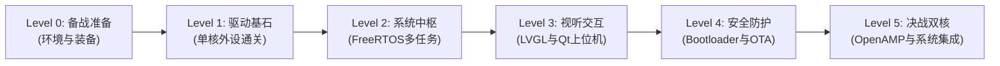
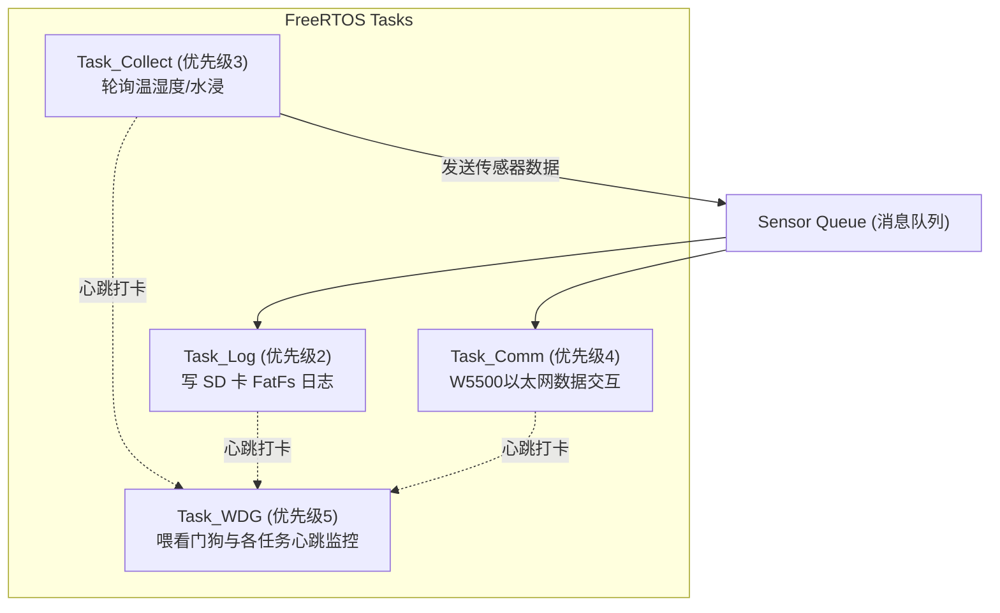
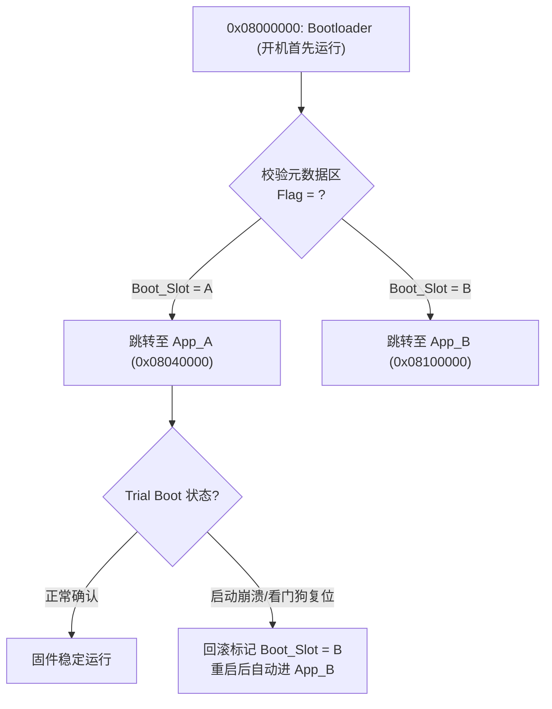

# STM32H747 工业机柜环境监护系统 · 新手保姆级通关任务清单

> 本手册专为**零基础 / 初学者**设计。本系统直接做双核极其容易挫败，因此我们将庞大的工业项目拆解为 **6 个阶梯等级（Level 0 ~ Level 5）**、**22 个具体实践微任务**。
> **原则：每一步只攻克一个独立知识点，做完即验证，像通关游戏一样层层打通。**

---

## 阶段规划概览

---

## Level 0: 装备整备与环境搭建（预计用时：1 周）

### 任务 0.1：硬件装备采购清单（必不可少）
- [ ] **核心主控板**：优先推荐国内成熟品牌的 STM32H747 开发板（如野火 H747 Pro、正点原子 H747 或安富莱 H743/H747）。*注：板载资源需包含 SDRAM、RGB 屏接口、以太网或 W5500、MicroSD 卡槽。*
- [ ] **仿真器/调试器**：DAP-Link（高速版）或 J-Link EDU/V10 / ST-Link V3（必须支持 SWD 调试 Cortex-M7/M4）。
- [ ] **工业外设模块**：
  - 1 个 RS485 接口的工业温湿度传感器（支持 Modbus RTU 协议，如 SHT30/SHT20 探头）。
  - 1 个电极式水浸传感器（开关量输出或模拟量电压输出）。
  - 1 个 W5500 SPI 以太网模块（如果板载没有集成）。
  - 1 个 USB 转 TTL 串口模块（CH340 或 CP2102）。
  - 1 个 4.3 寸或 7 寸 RGB 电容触摸液晶屏（配套开发板接口）。
  - 1 张 8GB/16GB MicroSD 卡（用于日志存储）。
- [ ] **硬件调试利器**：
  - **8 通道简易逻辑分析仪**（几十元即可，配合 PulseView/Saleae 软件，排查 RS485、SPI、I2C 时序问题的神器）。

### 任务 0.2：软件开发工具链安装
- [ ] 安装 **STM32CubeMX**（芯片图形化配置工具）。
- [ ] 安装开发 IDE：**Keil MDK 5.38+**（并安装 STM32H7 系列 Pack 包）或 **VS Code + Embedded IDE (EIDE) / STM32CubeCLT**。
- [ ] 安装 **Qt Creator**（推荐 Qt 5.14.2 或 Qt 6.5 LTS，选用 MinGW 编译器）。
- [ ] 安装辅助调试软件：
  - 串口助手（SSCOM 或 Vofa+）。
  - 工业 Modbus 测试软件：**Modbus Poll**（主站测试）与 **Modbus Slave**（从站测试）。
  - 网络调试助手（NetAssist）与 **Wireshark**（以太网抓包）。

### 任务 0.3：C 语言核心技能自测与补强
- [ ] **指针与内存**：理解内存地址、多级指针、函数指针（做设备驱动抽象必须用到）。
- [ ] **结构体字节对齐**：掌握 `#pragma pack(1)` 的意义（网络协议帧与 Modbus 帧打包必用，防止字节填充错位）。
- [ ] **位运算操作**：掩码操作（置 1、清 0、取反、移位），寄存器配置核心。
- [ ] **关键字特异性**：理解 `volatile` 在中断和双核共享变量中的决定性作用；理解 `static` 作用域。

---

## Level 1: 单核外设与硬件驱动基石（预计用时：2~3 周）

> [!NOTE]
> **开发策略**：在此阶段，先**把 H747 当作单核 MCU（只运行 CM7 核心）**，关闭 CM4，不开启 FreeRTOS。

### 任务 1.1：点灯、时钟树与调试环境
- **动作**：使用 CubeMX 配置 H747 CM7 主频到 400MHz/480MHz，配置 GPIO 输出翻转 LED，使用 SWD 烧录并设置断点调试。
- **验收标准**：LED 按 1Hz 闪烁，能够通过 IDE 单步调试、观察变量。

### 任务 1.2：工业级串口通信驱动（UART + DMA + 空闲中断 + RingBuffer）
- **动作**：
  1. 重定向 `printf` 到串口，实现调试日志打印。
  2. 实现基于 **DMA + USART 空闲中断（IDLE）** 接收不定长数据包。
  3. 编写一个通用的 **环形缓冲区（RingBuffer）**，将接收到的原始字节安全存入，供主程序解析。
- **验收标准**：通过串口助手以 115200 波特率发送任意长度（1~512字节）数据，系统无丢包完整回显。

### 任务 1.3：传感器模拟量采集与水浸报警逻辑（ADC + DMA）
- **动作**：
  1. 配置 ADC1 多通道 DMA 循环采样，读取水浸检测引脚与电位器电压。
  2. 编写**滑动均值滤波算法**，滤除工业高频噪点。
  3. 设定阈值（如电压 > 2.0V 触发水浸报警），联动控制板载蜂鸣器与报警 LED。
- **验收标准**：将水浸探头放入水中，串口实时打印出电压突变并在 100ms 内触发蜂鸣器报警。

### 任务 1.4：工业 RS485 总线与 Modbus RTU 探头轮询
- **动作**：
  1. 驱动带有自动/硬件方向引脚（DE/RE）的 RS485 收发芯片。
  2. 接入工业温湿度传感器，手动编写 Modbus RTU 功能码 `03H` 读取命令帧。
  3. 实现 CRC16 校验算法，校验传感器回传数据，解析出温度与湿度浮点值。
- **验收标准**：以 1 秒为周期轮询温湿度传感器，串口稳定输出当前的温度（℃）与湿度（%RH）。

### 任务 1.5：W5500 SPI 驱动与以太网 TCP 链路打通
- **动作**：
  1. 使用 CubeMX 配置硬件 SPI，移植 W5500 官方驱动库（ioLibrary Driver）。
  2. 为设备配置静态 IP（如 192.168.1.100）。
  3. 创建一个 TCP Client，连接电脑上的网络调试助手（TCP Server）。
  4. 加入简单的心跳保活（Keep-alive）机制与断线自动重连状态机。
- **验收标准**：插拔网线时，单片机能识别断开并在重新插上网线后 3 秒内恢复 TCP 连接，双向透传数据正常。

### 任务 1.6：MicroSD 卡与 FatFs 告警日志记录
- **动作**：
  1. 配置 SDMMC 接口，移植 FatFs 文件系统。
  2. 实现文件的挂载（`f_mount`）、创建（`f_open`）、追加写入（`f_write`）和刷盘（`f_sync`）。
  3. 编写告警日志模块：当发生水浸或温度超限时，在 SD 卡中追加写入一条格式化日志（如：`[2026-11-21 12:00:00][WARN] Temp: 45.2C Exceeded!`）。
- **验收标准**：电脑读取 SD 卡，能看到 `alarm.log` 文件，日志内容格式规范无乱码。

---

## Level 2: 操作系统 FreeRTOS 架构与解耦（预计用时：2 周）

> [!TIP]
> 裸机代码往往是 `while(1)` 大循环加延时，扩展性差。本等级的目标是将上述所有驱动模块用 FreeRTOS 任务解耦，完成任务优先级规划。

### 任务 2.1：FreeRTOS 多任务划分与队列通信
- **动作**：
  1. 创建 `Task_Collect`（采集任务）：周期性轮询温湿度和水浸。
  2. 创建 `Task_Comm`（通信任务）：负责 W5500 网络数据收发。
  3. 创建 `Task_Log`（日志任务）：负责 SD 卡落盘。
  4. 使用 **FreeRTOS Queue（消息队列）** 传递采集到的环境结构体数据，严禁使用裸全局变量跨任务无保护读写。
- **验收标准**：各任务独立运行，利用 FreeRTOS 运行时状态查看器（Runtime Stats）确认 CPU 使用率与堆栈水位（High Water Mark）均在安全范围。

### 任务 2.2：互斥锁（Mutex）与临界区保护
- **动作**：当多个任务都需要调用串口输出调试信息，或者多任务访问 SPI 总线时，使用 `SemaphoreHandle_t xSemaphoreCreateMutex()` 进行互斥保护。
- **验收标准**：多任务频繁打印日志时，串口终端输出不出现文字穿插或乱码。

### 2.3 任务：独立看门狗（IWDG）与任务级看门狗监控
- **动作**：
  1. 开启 IWDG，超时时间设为 2 秒。
  2. **进阶架构设计**：不要在某个单任务里无脑喂狗！设计一个 `Task_WDG`，其余任务必须在规定时间内向该任务“报到打卡”；只有全部任务正常运行，`Task_WDG` 才执行硬件喂狗。
- **验收标准**：人为故意让 `Task_Collect` 进入死循环，系统应在 2 秒内触发硬件复位重启。

---

## Level 3: 人机交互界面（LVGL）与 Qt 上位机（预计用时：2~3 周）

### 任务 3.1：LCD 屏驱动、SDRAM 显存与 DMA2D 硬件加速
- **动作**：
  1. 配置 FMC 接口驱动外部 SDRAM（初始化时钟、行/列地址、预充电延时）。
  2. 编写 SDRAM 读写测试函数，确保 32 位读写无误。
  3. 配置 LTDC（RGB 接口）控制器，将显存地址映射到外部 SDRAM。
  4. 开启 DMA2D 硬件外设，测试全屏快速刷色（红、绿、蓝）。
  5. 调通 I2C 电容触摸芯片（GT911/FT5426），读取触摸坐标。
- **验收标准**：触摸屏幕任意位置，屏幕跟随在触控点绘制一个小圆点，触控灵敏无漂移。

### 任务 3.2：LVGL 移植与核心监测界面设计
- **动作**：
  1. 导入 LVGL 8.x/9.x 源码，绑定显示缓冲区（使用双缓冲模式）与输入设备。
  2. 设计 **系统总览页（Overview）**：仪表盘显示当前温度/湿度数值、水浸状态图标（正常绿/告警红）。
  3. 设计 **I/O 状态页**：显示板载继电器闭合状态与蜂鸣器开关按钮。
  4. 设计 **参数设置页**：设置温湿度报警阈值，并在 Flash/EEPROM 中掉电保存。
- **验收标准**：UI 操作流畅度达到 50+ FPS，界面无明显撕裂卡顿。

### 任务 3.3：Qt 上位机开发（基础通讯版）
- **动作**：
  1. 使用 Qt Creator 创建基于 `QMainWindow` 的 C++ 桌面程序。
  2. 利用 `QTcpSocket` 实现 TCP 客户端，连接 STM32 设备端。
  3. 设计界面：显示当前网络连接状态、接收温湿度数据并绘制实时动态折线图（基于 `QCustomPlot` 或 `QChart`）。
- **验收标准**：单片机上传的数据在 Qt 上位机界面上实时刷新，折线图平稳波动。

---

## Level 4: 安全 Bootloader、A/B 分区与远程 OTA（预计用时：3 周）

> [!IMPORTANT]
> 这是整个系统工程化能力的核心分水岭。学会本部分，你将掌握高可靠固件升级的精髓。

### 任务 4.1：Flash 内存布局规划与单核 Bootloader
- **动作**：
  1. 划分芯片 Flash：
     - `0x0800 0000` ~ `0x0803 FFFF` (256KB): Bootloader
     - `0x0804 0000` ~ `0x080F FFFF` (768KB): App_A 分区
     - `0x0810 0000` ~ `0x081B FFFF` (768KB): App_B 分区
     - `0x081C 0000` ~ `0x081F FFFF` (256KB): Meta 元数据区（记录活动槽位、试运行标志、版本信息）
  2. 编写 Bootloader 程序：检查 Meta 分区，通过函数指针执行安全跳转：
     - `__disable_irq()` 关总中断。
     - 切换 MSP 指针到 App 栈顶。
     - 跳转到 App 的 `Reset_Handler`。
  3. 修改 App 工程：在 `system_stm32h7xx.c` 中修改 `SCB->VTOR` 偏移量，并在链接脚本（`.icf` 或 `.sct`）中将 Flash 起始地址改为 `0x08040000`。
- **验收标准**：Bootloader 运行后打印跳转日志，能够 100% 成功跳转并启动 App。

### 任务 4.2：自定义二进制分块 OTA 协议与 Flash 擦写
- **动作**：
  1. 定义升级帧协议格式：
     - `[0xAA 0x55][CMD_TYPE][PACK_INDEX][DATA_LEN][PAYLOAD (如1024字节)][CRC32]`
  2. App 接收固件块，逐块校验 CRC32，调用 HAL 库接口写入备用分区（如当前在 A，则写入 B）。
  3. 全部传输完成，进行整包固件的最终完整性校验。
- **验收标准**：通过上位机下发固件文件，App 端完整接收并烧写入指定 Flash 扇区。

### 任务 4.3：Trial Boot 试启动与防变砖安全回滚机制
- **动作**：
  1. 升级完成后，将 Meta 区标志设为 `TRIAL_BOOT_B`，重启设备。
  2. Bootloader 发现是试启动状态，跳转进 App_B，同时启动硬件看门狗。
  3. App_B 启动后执行自检（传感器、网络、总线是否正常）。如果自检通过，向 Meta 区写入 `CONFIRMED_VALID`；若因程序 Bug 崩溃或进 HardFault，看门狗复位，Bootloader 发现未被确认，自动将槽位切回 App_A（实现**自动回滚**）。
- **验收标准**：故意烧录一个带死循环的错误固件，设备重启后能自动检测失败并安全回退到原固件，设备不失联、不变砖。

### 任务 4.4：Qt 上位机 OTA 升级模块实现
- **动作**：
  1. Qt 增加“固件升级”页面：文件选择框（选择 `.bin` 文件）、版本解析、升级进度条、传输速率显示。
  2. 实现传输会话管理：断线重连、数据包超时重发、断点续传（记录上次已传包序号）。
- **验收标准**：Qt 上位机能够通过以太网 TCP 稳定将固件推送升级完成。

---

## Level 5: 决战 STM32H747 双核异构与全系统整合（预计用时：3~4 周）

> [!CAUTION]
> 终极考核！将此前在单核上实现的功能，按照系统职责正式分配给 CM7 与 CM4 双核，并打通 OpenAMP。

### 任务 5.1：STM32H747 双核工程建立与资源划分
- **动作**：
  1. CubeMX 创建 Dual Core 工程。
  2. **时钟分配**：CM7 运行在 400MHz/480MHz，CM4 运行在 200MHz/240MHz。
  3. **职责划分**：
     - **CM4 专职核**：传感器采集、ADC、RS485 Modbus 主站轮询。
     - **CM7 主控核**：LVGL 界面显示、W5500 以太网 TCP、USB CDC Modbus 从站、Bootloader/OTA 决策。
  4. 掌握上电启动时序：CM7 上电后初始化时钟并运行，通过调用 `HAL_RCCEx_EnableBootCore(RCC_BOOT_C2)` 唤醒释放 CM4。
- **验收标准**：两个核心各自控制一个独立 LED，双核同时以不同频率闪烁，单步调试两个核互不影响。

### 任务 5.2：攻克 Cortex-M7 L1 Cache 一致性难题
- **动作**：
  1. 深入理解：CPU 写数据在 D-Cache（Write-Back），而 DMA 发送直接从 SRAM 拿，会导致发送旧数据；DMA 接收数据到 SRAM，CPU 读取直接从 Cache 拿，会导致读不到新数据。
  2. 配置 MPU（内存保护单元）：
     - 将以太网/SPI DMA 缓冲区所在 RAM 区配置为 **Shareable / Non-Cacheable**。
     - 在 LVGL 显存刷屏操作时，显式调用 `SCB_CleanDCache_by_Addr()`。
- **验收标准**：以太网和屏幕高负载并发运转 24 小时，无死机、花屏、通信静默等因 Cache 导致的异常。

### 任务 5.3：OpenAMP 双核 IPC 通信落地
- **动作**：
  1. 在 CubeMX 中勾选并配置 OpenAMP 协议栈。
  2. 规划 SRAM4 作为核间共享内存（Shared RAM），配置 HSEM（硬件信号量）。
  3. 定义核间通讯帧格式（RPMsg Endpoint）：
     - CM4 将采集到的温度、湿度、水浸电压打包成结构体，通过 `OPENAMP_send()` 发送给 CM7。
     - CM7 收到 RPMsg 回调后，将数据存入共享缓存，供 LVGL 刷新和网络上报。
- **验收标准**：CM4 采集的温湿度变化能实时（延迟 < 50ms）体现在 CM7 驱动的 LVGL 屏幕上。

### 任务 5.4：CM7 侧 Modbus 从站（USB CDC 虚拟串口）
- **动作**：
  1. 在 CM7 运行 USB CDC 虚拟串口驱动。
  2. 搭建 Modbus RTU 从站协议栈：
     - 将保持寄存器（40001~40010）映射为温湿度、水浸状态与报警阈值。
     - 将线圈（00001~00002）映射为继电器和蜂鸣器控制输出。
- **验收标准**：电脑用 USB 线连接单片机，打开 Modbus Poll 软件，能成功读出保持寄存器的实时环境参数，并能写线圈控制蜂鸣器开闭。

### 任务 5.5：双核固件联动 OTA 与静默保护
- **动作**：
  1. OTA 时，升级包可能包含 CM7 固件，也可能包含 CM4 固件。
  2. 当 CM7 准备刷写 CM4 对应的 Flash 扇区时，CM7 必须先通过 OpenAMP 发送握手信号让 CM4 停止所有外设并进入安全睡眠态（或通过 RCC 将 CM4 保持复位）。
  3. Flash 烧写并校验通过后，CM7 再重新释放 CM4 复位。
- **验收标准**：通过以太网远程升级 CM4 固件，升级过程无总线冲突，重启后 CM4 顺利运行新功能。

### 任务 5.6：全系统工业级压力测试与验收
- **测试动作**：
  - [ ] **高频轮询压力**：上位机以 50ms 频率快速查询 Modbus 寄存器，观察 LVGL 界面是否掉帧。
  - [ ] **异常网络断线**：在 OTA 传输到 50% 时拔掉以太网线，恢复后验证是否能断点续传或安全回滚。
  - [ ] **电源突变故障**：在固件写入瞬间拔掉电源，重新上电验证 Bootloader 启动管理，确认旧版本 App 依然完好并能正常启动。
  - [ ] **连续无故障运行**：整机组装进机柜模型，连续高低温或常温拷机 72 小时无死机、无内存泄露。
- **最终成果交付**：
  - 完整的软硬件工程代码（CubeMX、Keil/VSCode 固件源码、Qt 上位机源码）。
  - 一份技术架构总结与工业排障手册。
