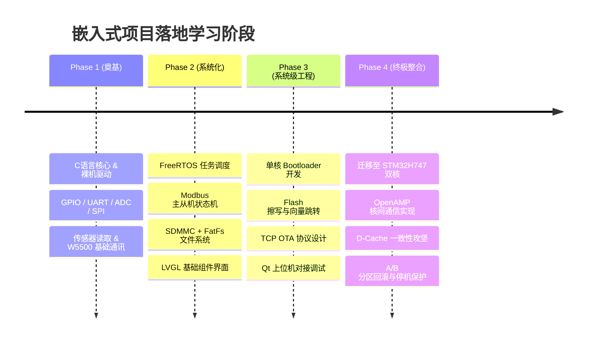

# 基于 STM32H747 工业机柜环境监护系统 · 技能树与学习路线全景图

> 本文档面向希望以“**基于 STM32H747 的工业机柜环境监护系统**”为目标项目的嵌入式开发者，系统拆解该项目涉及的全部知识栈，并提供由浅入深、循序渐进的学习落地路径。

---

## 一、 项目本质与含金量客观评估

该项目是一个典型的**工业级中高级嵌入式综合项目**，其技术含金量在同类项目中处于第一梯队，主要体现在以下几个硬核维度：

1. **异构多核架构（Dual-Core Heterogeneous）**：ARM Cortex-M7 (480MHz) + Cortex-M4 (240MHz)，运行 OpenAMP/RPMsg 进行核间 IPC 通信与数据共享。
2. **高性能 MCU 架构挑战**：STM32H7 特有的 AXI 总线矩阵、多域内存分布（ITCM/DTCM/AXI SRAM/SRAM1~4）以及 **L1 Cache（D-Cache/I-Cache）一致性维护**。
3. **高可靠工业固件架构**：双核 Bootloader + 双分区（A/B Bank）OTA + 试启动校验（Trial Boot）+ 自动回滚 + 停核静默保护。
4. **全栈通信链路**：
   - 现场工业总线：RS485 + Modbus RTU（主站轮询探头）。
   - 本地人机交互与调试：USB CDC 虚拟串口 + Modbus RTU 从站。
   - 远程工业物联网：W5500 SPI 以太网 + 自定义二进制 TCP 传输协议。
   - 上位机全栈：基于 Qt (C++) 开发支持断点续传的双通道运维上位机。
5. **复杂交互与边缘存储**：LVGL 工业 HMI（SDRAM + DMA2D 硬件加速）+ SDMMC/FatFs 边缘日志轮转。

> [!WARNING]
> **新人避坑警示**：
> 如果你处于嵌入式**零基础或刚接触单片机**阶段，**千万不要从第一天起就硬啃 STM32H747 双核**！H7 的总线与 Cache 机制会让初学者的调试成本极高（例如：DMA 读写正常但 CPU 读出旧数据、双核启动死锁、HardFault 等）。
> **最佳学习策略**：以该项目为**终极航标**，采用“**分解单项技术 -> 单核平台打通 -> 渐进集成升级到 H747 双核**”的路线。

---

## 二、 完整技能树全景拆解

```mermaid
flowchart TD
    subgraph S1["1. 编程与算法基础"]
        C["高级 C 语言 / C++"]
        FSM["有限状态机 (FSM)"]
        RingBuf["环形缓冲区 (RingBuffer)"]
        CRC["CRC16/CRC32 校验算法"]
    end

    subgraph S2["2. 处理器与芯片底层架构"]
        Cortex["ARM Cortex-M7 / M4 内核"]
        Bus["STM32H7 AXI/AHB 总线矩阵"]
        Cache["L1 Cache 一致性 & MPU"]
        Flash["Dual-Bank Flash 擦写特性"]
    end

    subgraph S3["3. 驱动与硬件外设"]
        UART["UART / RS485 (DMA+空闲中断)"]
        SPI_ETH["SPI 驱动 & W5500 硬件协议栈"]
        ADC_SEN["ADC 采样 / 滤波 / 水浸与温湿度"]
        USB["USB CDC 虚拟串口协议栈"]
        Storage["SDMMC + FatFs 文件系统"]
        Screen["FMC(SDRAM) + LTDC + DMA2D + 触摸"]
        Watchdog["IWDG 看门狗与心跳管理"]
    end

    subgraph S4["4. 操作系统与双核中间件"]
        FreeRTOS["FreeRTOS (任务/队列/信号量/内存池)"]
        OpenAMP["OpenAMP 框架 (RPMsg, VirtIO, 共享内存)"]
        HSEM["硬件信号量 (HSEM) 与核间中断"]
    end

    subgraph S5["5. 协议与交互"]
        Modbus["Modbus RTU (主站/从站双角色实现)"]
        LVGL["LVGL 图形库移植、组件与事件驱动"]
        CustomProto["自定义二进制 TCP OTA 协议"]
    end

    subgraph S6["6. 系统级工程与上位机"]
        Bootloader["A/B 分区 Bootloader & 向量表重定向"]
        OTA["固件分块接收/校验/防变砖回滚机制"]
        QtApp["Qt (C++) 上位机 (网络/串口多线程编程)"]
    end

    S1 --> S2 --> S3 --> S4 --> S5 --> S6
```

---

## 三、 六大知识域详解与技能要求

### 1. 编程语言与嵌入式核心基础
- **高级 C 语言功底**：
  - 指针深度应用：函数指针（用于回调机制、驱动接口分层）、多级指针、指针算术。
  - 内存布局与字节对齐：`#pragma pack`、`__attribute__((packed))`、大端小端（Big/Little Endian）网络字节序转换。
  - 数据结构：环形队列（Circular/Ring Buffer）在串口收发中的实现、链表结构在对象管理中的使用。
- **协议算法**：
  - CRC16（Modbus 使用）、CRC32（固件镜像合法性与数据帧校验）。
  - 滑动窗口均值滤波、中位值滤波（ADC 传感器滤波处理）。

### 2. ARM Cortex-M 体系与 STM32H7 特殊架构
- **Cortex-M7 与 M4 双核机制**：
  - 双核启动流程：上电后默认只有 CM7 启动，CM7 完成基础时钟与电源配置后，通过唤醒机制释放 CM4。
  - 向量表重定位（`SCB->VTOR`）：Bootloader 跳转到 App 的核心底层操作。
- **内存分域与 Cache 一致性（本项目最大难点之一）**：
  - H7 具有 D1、D2、D3 三个电源域，分别挂载 ITCM、DTCM、AXI SRAM、SRAM1~4。
  - **L1 D-Cache 一致性**：当 DMA 外设直接修改内存时，CPU Cache 中仍可能是旧数据；必须掌握 MPU（内存保护单元）配置 Non-Cacheable 区域，或在 DMA 启动前/完成后手动调用 `SCB_CleanDCache()` 和 `SCB_InvalidateDCache()`。

### 3. 外设接口与硬件驱动开发
- **通信总线**：
  - **UART + RS485**：硬件流控方向引脚（RE/DE）控制、USART 配合 DMA + 空闲中断（IDLE Interrupt）接收不定长数据帧。
  - **SPI**：高速 SPI 驱动硬件以太网芯片 **W5500**，掌握 W5500 内部寄存器控制与 Socket 状态机。
  - **USB**：基于 STM32 USB Device 库实现 USB CDC 虚拟串口通讯。
- **模拟采集与传感器**：
  - 内部 ADC 多通道 DMA 采样、电压换算，水浸开关量/电阻量检测电路逻辑。
- **外部存储与多媒体**：
  - **SDMMC + FatFs**：FAT32 文件系统移植，实现日志文件的循环创建、写入刷新与大小轮转（Log Rotation）。
  - **FMC + SDRAM**：外部 16/32 位 SDRAM 显存配置与时序调优。
  - **LTDC + DMA2D (Chrom-ART)**：RGB 屏驱动控制器配置，使用 DMA2D 硬件实现颜色填充、显存拷贝与透明混合加速。
  - **I2C 触控芯片**：GT911 / FT5426 电容触摸屏中断驱动。

### 4. 实时操作系统（FreeRTOS）与双核通信（OpenAMP）
- **FreeRTOS 实战**：
  - 任务划分、优先级分配与堆栈大小评估（防止堆栈溢出）。
  - 任务间同步与通信：队列（Queue）传递温湿度数据、二值信号量（Semaphore）同步中断事件、互斥锁（Mutex）保护临界资源、事件标志组（Event Group）管理系统状态。
  - 软件定时器、空闲钩子与看门狗任务监控。
- **OpenAMP 双核通信**：
  - 理解 **RPMsg**（Remote Processor Messaging）和 **VirtIO** 的底层原理。
  - 共享内存（Shared Memory，通常在 SRAM4 或 AXI SRAM）规划。
  - 硬件信号量（HSEM）触发核间中断，实现 CM4 采集温湿度并实时上报给 CM7。

### 5. 工业协议与图形界面
- **Modbus RTU 双角色实现**：
  - **CM4 侧（主站 Master）**：通过 RS485 周期性发送功能码 03H（读取保持寄存器），轮询温湿度传感器，解析返回数据。
  - **CM7 侧（从站 Slave）**：通过 USB CDC 虚拟串口接收上位机轮询，实现功能码 01H/05H（线圈读写，控制继电器/蜂鸣器）与 03H/06H/10H（保持寄存器读写与掉电保存）。
- **LVGL (Light and Versatile Graphics Library)**：
  - 移植 LVGL 8.x 或 9.x 到 STM32H7，打通显存刷新接口（`flush_cb`）与触摸读取接口（`read_cb`）。
  - 双缓冲机制（Double Buffering）避免画面撕裂。
  - UI 架构设计：主控概览页（Overview）、I/O 监控页、系统参数页、报警历史页。

### 6. Bootloader、安全 OTA 与 Qt 上位机
- **Bootloader & A/B 分区规划**：
  - Flash 空间划分：
    - `0x08000000`: Bootloader 区域
    - `0x08040000`: App A 分区（活动区）
    - `0x08100000`: App B 分区（备用区/升级区）
    - `0x081E0000`: 元数据区（存储当前运行槽位、试运行标志、固件版本、CRC）
  - 启动选择逻辑、镜像完整性校验、试启动机制（Trial Boot）：开机启动看门狗，App 正常启动后向 Bootloader 发送“确认就绪”，否则复位后自动回滚到 Golden 镜像。
  - 双核 OTA 特殊处理：CM7 升级 CM4 固件前，必须先暂停/复位 CM4 并静默核间总线。
- **Qt 上位机开发**：
  - Qt Creator、C++11/14 基础。
  - `QTcpSocket` 与 `QSerialPort` 双通道抽象，单例或工厂模式统一通信接口。
  - 自定义固件升级协议：分包大小（如 1KB 一包）、序列号、重传机制、断点续传。

---

## 四、 四阶段进阶通关路径（由零到一）

为了避免一开始陷入多核调试的泥潭，强烈推荐以下**四个阶段**演进：

### 阶段一：单核外设与硬件驱动基础（1~2 个月）
*   **目标**：掌握 ARM Cortex-M 基础、CubeMX 配置与常用底层总线。
*   **行动项**：
    1. 使用 STM32F4 或 H7 单核跑裸机代码。
    2. 编写 UART 驱动（DMA+空闲中断不定长接收），封装 RingBuffer。
    3. 连接 RS485 温湿度传感器，手动解析串口数据。
    4. 驱动 SPI 接口的 W5500，使用网络调试助手测试 TCP Client/Server 通信。
    5. 实现 ADC 采集外部水浸传感器模拟量。

### 阶段二：RTOS 多任务协同与界面交互（1~1.5 个月）
*   **目标**：引入操作系统与图形人机界面，打通工业协议。
*   **行动项**：
    1. 引入 FreeRTOS：创建传感器采集任务、通信任务、监控任务。
    2. 实现 Modbus RTU 协议栈：主站轮询传感器，从站响应寄存器读写。
    3. 挂载 SD 卡并移植 FatFs，实现简单数据记录（CSV 或 TXT）。
    4. 驱动 LCD 屏幕与触摸芯片，移植 LVGL，设计基础监测页面。

### 阶段三：安全 Bootloader 与 Qt 上位机（1~1.5 个月）
*   **目标**：掌握系统升级的核心底层原理与上位机通信全流程。
*   **行动项**：
    1. 学习 Flash 内部结构、扇区擦除与字编程 API。
    2. 独立开发单核 Bootloader：实现 Flash 分区、向量表偏移、从 Boot 跳转至 App。
    3. 设计自定义分块 OTA 协议（包含包头、偏移量、数据包、CRC 校验、ACK/NAK）。
    4. 使用 Qt 编写桌面软件：加载 `.bin` 固件文件，通过 TCP 或串口将固件分块下发给 MCU。
    5. 实现 A/B 双分区逻辑与 Trial Boot 失败回滚保护机制。

### 阶段四：STM32H747 双核异构与全系统整合（1~2 个月）
*   **目标**：全面登顶，攻克该项目的全部工业级高级特性。
*   **行动项**：
    1. **双核启动与资源划分**：配置 CubeMX 双核工程，分配时钟树与外设引脚归属（CM4 管传感器与 RS485，CM7 管屏、以太网与算法）。
    2. **OpenAMP 移植与核间通讯**：配置共享内存与 HSEM，利用 RPMsg 跑通 CM4 向 CM7 上报温湿度与水浸状态。
    3. **攻坚 Cache 一致性**：配置 MPU，为 W5500 DMA 缓冲、LVGL 显存、OpenAMP 共享内存设置正确的内存属性。
    4. **双核协同 OTA**：在 CM7 上执行升级逻辑，升级 CM4 时下发停核握手信号，静默总线，完成双核固件独立更新与联动校验。
    5. **系统压测与看门狗联调**：模拟网络断线重连、传感器掉线、升级中途断电、异常固件防变砖测试。

---

## 五、 关键“深水区”与避坑要点预警

在学习过程中，遇到以下问题时请优先查阅本节：

> [!CAUTION]
> 1. **D-Cache 导致的数据“幻读”与“未落盘”**
>    - **现象**：DMA 接收了串口/以太网数据，但在内存变量中读取到的仍然是旧内容；或者发送缓冲区填入新数据，DMA 发送出去的却是旧数据。
>    - **原因**：Cortex-M7 开启了 D-Cache，CPU 读取/写入命中 Cache，而 DMA 直接访问物理 RAM。
>    - **解法**：为 DMA 缓冲区配置 MPU（属性设为 Shareable / Non-Cacheable），或者在 DMA 操作前执行 `SCB_CleanDCache()`，DMA 接收完成后执行 `SCB_InvalidateDCache()`。

> [!IMPORTANT]
> 2. **Bootloader 跳转后立刻进入 HardFault**
>    - **检查清单**：
>      1. 跳转前是否已**关闭所有外设中断**（`__disable_irq()`）？
>      2. 跳转前是否清除所有的 PendSV、SysTick 标志？
>      3. App 的 `system_stm32h7xx.c` 中是否正确设置了 `SCB->VTOR` 偏移量？
>      4. 跳转代码中是否正确重置了主堆栈指针（MSP）：`__set_MSP(*(uint32_t*)APP_FLASH_ADDR)`？

> [!NOTE]
> 3. **双核死锁与 OpenAMP 初始化失败**
>    - CM7 与 CM4 的初始化存在严格的时间依赖。CM7 必须先初始化时钟、电源、共享内存并释放 CM4，CM4 才能启动并建立 VirtIO 握手。
>    - 核间通信严禁在中断服务函数（ISR）中进行耗时阻塞操作。

---

## 六、 硬件采购与实验环境搭建建议

为完整复现该项目，建议准备如下硬件与工具：

| 类别 | 推荐选型 / 设备 | 作用与说明 |
| :--- | :--- | :--- |
| **主控板** | STM32H747I-DISCO（官方探索板）或 正点原子/野火/安富莱双核开发板 | 必须具备双核 H747 芯片，板载 SDRAM 与 Flash |
| **网络模块** | W5500 SPI 以太网模块 | 工业常用硬件 TCP/IP 协议栈芯片 |
| **现场传感器** | RS485 Modbus 温湿度传感器（如 SHT30 探头）、电极式水浸传感器 | 用于模拟工业机柜现场采集场景 |
| **屏幕** | 4.3 寸或 7 寸 RGB/MIPI 接口触摸电容屏 | 供 LVGL 界面显示与交互 |
| **外扩存储** | MicroSD 卡（工业级）或 板载 SD NAND | 用于 FatFs 告警日志留存 |
| **调试工具** | DAP-Link 或 J-Link V9/V10 / ST-Link V3 | 必备双核调试器，支持多核断点联调 |
| **测量仪器** | 8 通道便携式逻辑分析仪（如 24MHz 简易版） | **必备神器**，抓取 RS485、SPI、I2C 时序与波形 |
| **软件环境** | STM32CubeMX + VS Code (EIDE/Clangd) 或 Keil MDK 5 + Qt Creator | 嵌入式与上位机开发集成环境 |
